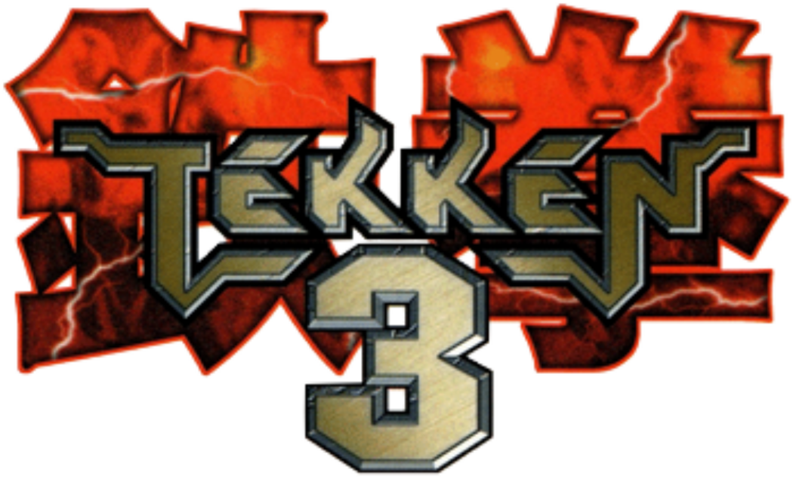

<p align="center">
  
</p>

# Tekken 3 (USA) — Nintendo Switch Native Port

[](https://github.com/markaurel13/tekken3_nx)
[]()
[-blue.svg)](https://github.com/fincs/deko3d)
[-purple.svg)]()
[](https://github.com/markaurel13)

A high-performance, native static recompilation port of **Tekken 3** (NTSC-U / SLUS-00402) for the Nintendo Switch.

Unlike traditional emulation, this port statically recompiles original PlayStation 1 MIPS binaries directly into native ARM64 machine code, coupled with a purpose-built **deko3d** hardware graphics renderer and native **audren** sound architecture.

---

## ✨ Features

- **Rock-Solid 60 FPS on Stock Clocks:** Direct native execution with zero emulation overhead, running at a locked 60 FPS.
- **Internal Supersampling Anti-Aliasing (Game Resolution):**
  - **2x HD (Default):** Crisp polygon edges and optimal performance (Full HD)
  - **3x Ultra HD:** Maximum polygon edge definition for 4K / large TV screens via `sdmc:/switch/tekken3/config.txt` *(Note: Since the Switch output is capped at 1080p, 3x SSAA is overkill and may cause occasional frame drops to ~55 FPS)*.
  - **1x PS1 Native:** Authentic retro 1024x512 resolution for purists.
- **Aspect Ratio Options:**
  - **4:3 Original (Default):** Authentic retro proportions with clean black pillarbox sidebars.
  - **16:9 Fullscreen Widescreen:** Fills the full 720p handheld or 1080p docked display without sidebars (toggleable in `sdmc:/switch/tekken3/config.txt`).
- **Pixel-Perfect Rendering:**
  - Custom deko3d shader pipeline with bilinear edge inset filtering to eliminate PlayStation VRAM border bleed.
- **2-Player Local Battles:**
  - Automatic controller assignment supporting handheld mode, Pro Controllers, split Joy-Cons, and generic USB/wireless gamepads.
- **All Game Modes Supported:**
  - Arcade, VS Battle, Team Battle, Survival, Time Attack, Practice, Tekken Force, and Tekken Ball.

---

## 📁 Installation & File Structure

1. Extract the release package onto the root of your Nintendo Switch microSD card.
2. Place your own copy of **Tekken 3 (USA)** disc image (`.cue` and `.bin`) inside the `disc/` subfolder.
   - **Supported Version:** NTSC-U / SLUS-00402 (USA version).
3. (Optional) Use Sphaira to generate a Home Menu shortcut so you can launch the game directly without entering the Homebrew Menu.

Your directory structure on the microSD card should look like this (Before first launch):

```text
sdmc:/
└── switch/
    └── tekken3/
        ├── tekken3_nx.nro              
        ├── config.txt                  
        ├── disc/
        │   ├── Tekken 3 (USA).cue       
        │   ├── Tekken 3 (USA) (Track 1).bin
        │   ├── Tekken 3 (USA) (Track 2).bin   
        │   └── Tekken 3 (USA) (Track 3).bin   
```

> **Note:** The port includes an intelligent universal disc detector. While standard names like `Tekken 3 (USA).cue` are recommended, it will automatically search, match, and mount any compatible `.cue`, `.bin`, `.iso`, or `.chd` placed inside the `disc/` or `tekken3/` directory regardless of file naming.

>  [!TIP]
> **Enable Auto Save on First Launch:** Once in-game, Go to **OPTION MODE** → **MEMORY CARD** and turn **AUTO SAVE: ON**. This ensures your progress is saved automatically whenever you finish a mode, unlock a character, or set a new record

---

## ⚙️ Graphics Configuration (`config.txt`)

You can customize graphical settings by editing [`config.txt`](config.txt) located in `sdmc:/switch/tekken3/config.txt`:

```ini
# ==============================================================================
# Tekken 3 (USA) - Graphics Configuration for Nintendo Switch
# ==============================================================================
# Place this file in the same directory as 'tekken3_nx.nro' on your microSD card
# (e.g. sdmc:/switch/tekken3/config.txt).
# If this file is missing, the game will automatically create it with default values.
#
# ------------------------------------------------------------------------------
# Internal Supersampling Anti-Aliasing (SSAA):
#   1 = 1x PS1 Native (1024x512)
#   2 = 2x HD (2048x1024) [RECOMMENDED]
#       -> Sharp edges, optimal configuration
#   3 = 3x Ultra HD (3072x1536)
#       -> Maximum polygon edge definition for 4K / large TV screens (Switch has a 1080p limit, so it is overkill and may cause FPS drops to 55 FPS)
# ------------------------------------------------------------------------------
supersampling = 2

# ------------------------------------------------------------------------------
# Screen Aspect Ratio:
#   OFF = 4:3 Original with black sidebars [RECOMMENDED IF YOU WANT THE ORIGINAL EXPERIENCE]
#         -> Preserves authentic retro proportions for characters and stages.
#   ON  = 16:9 Fullscreen Widescreen
#         -> Fills the entire Switch screen and 16:9 TV display without bars.
# ------------------------------------------------------------------------------
widescreen_16_9 = OFF
```

---

## 🎮 Controls

### Player 1 (Handheld or Gamepad Controller)
| PS1 Button | Nintendo Switch | Action |
|:---:|:---:|:---|
| **D-Pad / Left Stick** | **D-Pad / Left Stick** | Movement & Crouching |
| **Square ($\Box$)** | **Y** | Left Punch (LP) |
| **Triangle ($\Delta$)** | **X** | Right Punch (RP) |
| **Cross ($\times$)** | **B** | Left Kick (LK) |
| **Circle ($\bigcirc$)** | **A** | Right Kick (RK) |
| **L1 / L2** | **L / ZL** | Customizable shortcut |
| **R1 / R2** | **R / ZR** | Customizable shortcut |
| **Start** | **+ (Plus)** | Pause Menu (Arcade / VS / Practice) |
| **Select** | **- (Minus)** | Select / Options |

> **2-Player Mode:** Connecting a second controller automatically registers Player 2 for local multiplayer battles.

---

## 🛠️ Building from Source

### Prerequisites
- [devkitPro](https://devkitpro.org/) with `devkitA64`, `libnx`, `deko3d`, and `switch-tools`.
- CMake (version 3.20 or newer) and Ninja.

### Build Steps
```bash
# Clone the repository
git clone https://github.com/markaurel13/tekken3_nx.git
cd tekken3_nx

# Configure CMake with devkitPro Switch toolchain
cmake -B build-switch -G Ninja \
  -DCMAKE_TOOLCHAIN_FILE=/opt/devkitpro/cmake/Switch.cmake \
  -DCMAKE_BUILD_TYPE=Release

# Build the .nro package
ninja -C build-switch
```

The compiled binary and configuration files will be output to:
- `build-switch/tekken3_nx.nro`
- `build-switch/config.txt`

---

## ⚖️ Disclaimer & Legal

*Tekken 3* is a registered trademark of Bandai Namco Entertainment Inc. This project is an independent, non-commercial open-source native reimplementation designed strictly for homebrew-enabled Nintendo Switch consoles.

No proprietary game assets, disc ROMs, BIOS dumps, or copyrighted code are distributed with this repository or release packages. Users must provide their own copy of *Tekken 3* (USA, SLUS-00402) for PlayStation.

---

## 🏆 Credits & Acknowledgments

- **[markaurel13](https://github.com/markaurel13):** Nintendo Switch native port author, custom deko3d rendering backend, audren sound engine, input handling, and platform integration.
- **[FishB0nes98](https://github.com/FishB0nes98):** Author of the original [Tekken 3 Recompiled](https://github.com/FishB0nes98/Tekken3Recompiled) project.
- **[mstan](https://github.com/mstan):** Creator of the groundbreaking [psxrecomp](https://github.com/mstan/psxrecomp) static recompiler and [recomp-ui](https://github.com/mstan/recomp-ui).
- **[FinCS](https://github.com/fincs):** Creator of the [deko3d](https://github.com/fincs/deko3d) low-level graphics library for the Nintendo Switch Nvidia Tegra X1 GPU.
- **[devkitPro & libnx contributors](https://github.com/devkitPro/libnx):** The foundational SDK, toolchain, and system libraries powering Nintendo Switch homebrew development.
- **[OpenBIOS Project](https://github.com/mstan/openbios-psx):** Open-source PlayStation BIOS implementation enabling clean, legal execution without proprietary firmware.
- **[libchdr & LZMA SDK](https://github.com/rtissera/libchdr):** Disc image compression and sector decoding libraries.
- **[Namco (Bandai Namco Entertainment)](https://www.bandainamcoent.com/):** The original developers and masterminds behind *Tekken 3* and its timeless gameplay.
